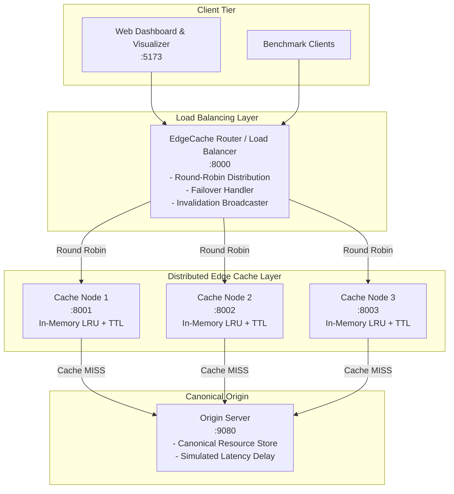

# EdgeCache: A Distributed Web Caching and Edge Computing Simulator

[](https://en.wikipedia.org/wiki/Distributed_computing)
[](https://www.python.org/)
[](https://fastapi.tiangolo.com/)
[](https://react.dev/)
[](https://www.docker.com/)
[](https://docs.pytest.org/)

**EdgeCache** is a full-featured distributed systems project designed for 3rd/final-year Computer Engineering students. It demonstrates core distributed systems principles through working, multi-process software:
- **Round-Robin Load Balancing** across edge cache nodes with dynamic failover.
- **Independent In-Memory LRU Caching** ($O(1)$ hash map + doubly linked list) with Time-To-Live (TTL).
- **Write-Invalidate Cache Coherence Protocol** across distributed nodes.
- **Origin Server Offloading & Latency Reduction** (>10,000× speedup demonstrated).
- **Partial Failure & Fault Tolerance Simulation** (crash and recover nodes live).
- **Futuristic Glassmorphic Monitoring Dashboard** (React + Vite) with real-time telemetry and guided viva experiment scenarios.

---

## Architecture Overview



---

## Quickstart Guide

### Option A: Local Multi-Process Mode (Fastest)

Run all 5 backend microservices and the Vite frontend dev server in one command:

```bash
# 1. Start all services
./start_local.sh

# 2. Open dashboard in your browser
# URL: http://localhost:5173

# 3. When finished, stop everything cleanly
./stop_local.sh
```

### Option B: Docker Compose

```bash
# Build and start all 6 containers
docker compose up --build

# Open http://localhost:5173
```

---

## Service Endpoints & Ports

| Service | Port | Description |
|---|---|---|
| **Frontend Dashboard** | `5173` | Interactive visualizer, experiment lab, topology map |
| **Router / Load Balancer** | `8000` | Ingress reverse proxy & load balancer |
| **Cache Node 1** | `8001` | Edge cache process 1 (independent LRU store) |
| **Cache Node 2** | `8002` | Edge cache process 2 (independent LRU store) |
| **Cache Node 3** | `8003` | Edge cache process 3 (independent LRU store) |
| **Origin Server** | `9080` | Source of truth with configurable simulated delay |

---

## Running Automated Tests

EdgeCache features a complete test suite covering LRU eviction, TTL expiration, HTTP hit/miss routing, round-robin load distribution, invalidation broadcast, and failover:

```bash
# Run all 65 unit & integration tests
PYTHONPATH=cache_node ./venv/bin/python -m pytest cache_node/tests
PYTHONPATH=origin_server ./venv/bin/python -m pytest origin_server/tests
PYTHONPATH=router ./venv/bin/python -m pytest router/tests
```

All 65 tests pass with 100% success rate.

---

## Course Documentation & Viva Preparation

Comprehensive documentation for academic review and presentation is located in [`docs/`](file:///home/prachi/Github/DS/docs/):

1. **[`docs/project_report.md`](file:///home/prachi/Github/DS/docs/project_report.md)**: Full formal academic project report with problem statement, distributed systems theory, algorithm design, benchmark analysis, and conclusions.
2. **[`docs/demo_guide.md`](file:///home/prachi/Github/DS/docs/demo_guide.md)**: 5-minute step-by-step presentation script for college examiners.
3. **[`docs/viva_questions.md`](file:///home/prachi/Github/DS/docs/viva_questions.md)**: 25 detailed Distributed Systems viva questions with answers (CAP theorem, cache consistency, LRU vs LFU, failure models, cache stampedes).
4. **[`docs/architecture.md`](file:///home/prachi/Github/DS/docs/architecture.md)**: Detailed system design specification and sequence diagrams.
5. **[`docs/api_documentation.md`](file:///home/prachi/Github/DS/docs/api_documentation.md)**: Full REST API specification with sample requests and responses.

---

## Directory Structure

```
/home/prachi/Github/DS/
├── README.md                 # Project documentation
├── docker-compose.yml        # Docker Compose orchestration
├── start_local.sh            # Launch all 6 services locally
├── stop_local.sh             # Graceful shutdown script
├── docs/                     # Academic reports & viva guide
│   ├── architecture.md
│   ├── api_documentation.md
│   ├── project_report.md
│   ├── demo_guide.md
│   └── viva_questions.md
├── origin_server/            # Source of truth server (:9080)
│   ├── Dockerfile
│   ├── main.py
│   └── tests/test_origin.py
├── cache_node/               # Distributed LRU cache nodes (:8001-:8003)
│   ├── Dockerfile
│   ├── main.py
│   ├── lru_cache.py
│   └── tests/
│       ├── test_cache.py
│       └── test_lru.py
├── router/                   # Load balancer & proxy (:8000)
│   ├── Dockerfile
│   ├── main.py
│   └── tests/test_router.py
└── frontend/                 # React 18 + Vite visualizer (:5173)
    ├── Dockerfile
    ├── package.json
    ├── src/
    │   ├── App.jsx
    │   ├── index.css
    │   ├── api/client.js
    │   └── components/
    │       ├── Navbar.jsx
    │       ├── StatsSummary.jsx
    │       ├── CacheNodeCard.jsx
    │       ├── RequestSimulator.jsx
    │       ├── RequestLog.jsx
    │       ├── ArchitectureView.jsx
    │       ├── ExperimentPanel.jsx
    │       └── ConfigModal.jsx
```
