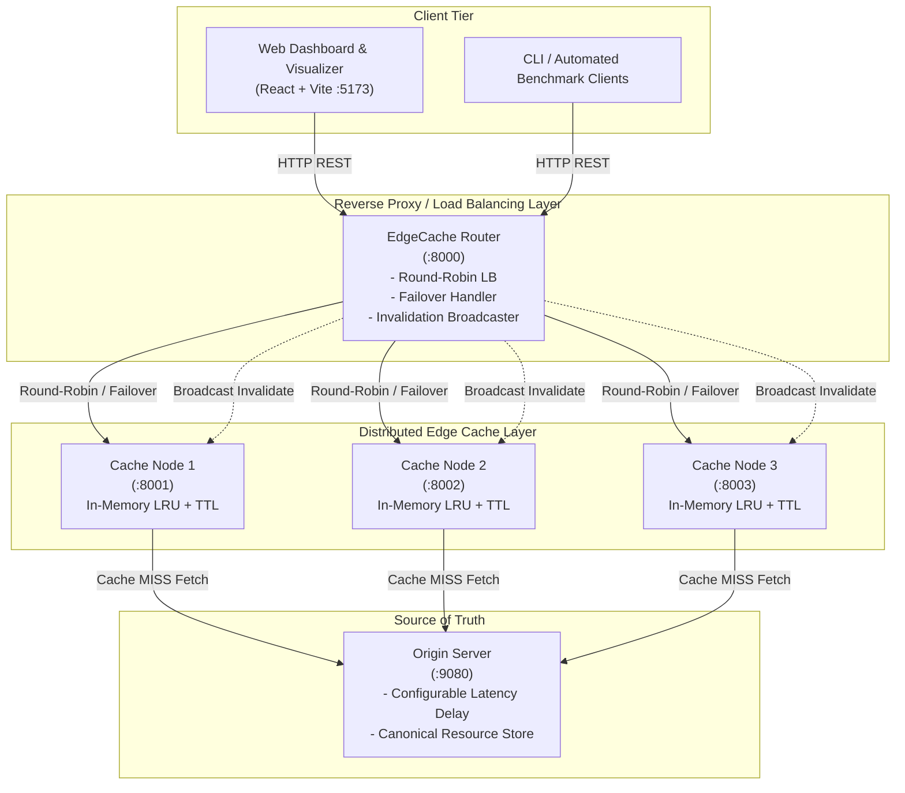
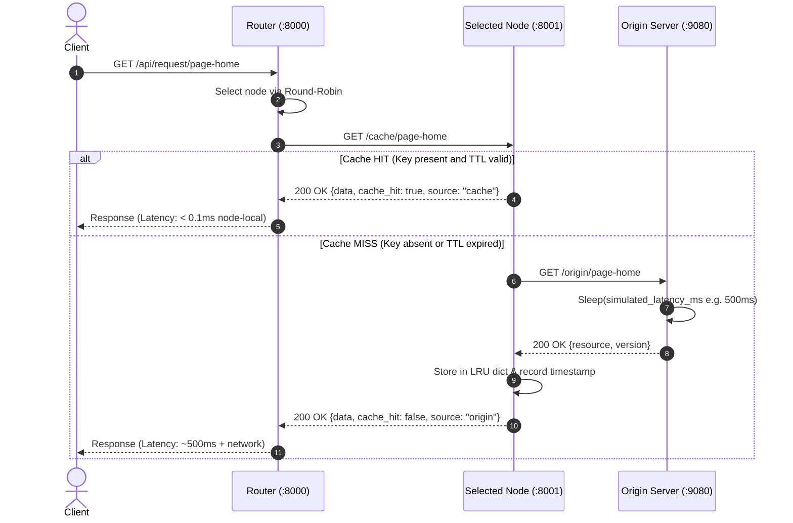

# EdgeCache Architecture & System Design Specification

## 1. Executive Summary

**EdgeCache** is a distributed web caching and edge computing simulation system designed to demonstrate fundamental distributed systems concepts. It comprises multiple independent processes communicating over the network via HTTP REST APIs:
- **Client Tier**: Web dashboard and programmatic load generators.
- **Routing & Load Balancing Layer**: Round-robin reverse proxy (:8000) with dynamic health checking and fault failover.
- **Distributed Cache Layer**: Three independent cache node processes (:8001, :8002, :8003) running custom in-memory Least-Recently-Used (LRU) algorithms with configurable Time-To-Live (TTL).
- **Origin Server**: The single source of truth (:9080) with simulated latency and stateful resource persistence.

---

## 2. Distributed Architecture Diagram

---

## 3. Request Flow & Cache State Machine

### 3.1 Cache Hit vs Miss Sequence

---

## 4. Key Distributed Systems Concepts Demonstrated

| Distributed Concept | Concrete Implementation in EdgeCache |
|---|---|
| **Process Independence** | Router, Origin, and all 3 Cache Nodes run in separate OS processes with disjoint memory address spaces. |
| **No Shared State** | Cache nodes do not share memory; each node maintains its own independent LRU cache. |
| **Load Distribution** | Router cycles incoming requests sequentially across healthy nodes using modular arithmetic `(index + 1) % N`. |
| **Partial Failure** | Any single cache node process can terminate abruptly while the remaining nodes and cluster continue serving requests without downtime. |
| **Automatic Failover** | If a node connection drops (`httpx.ConnectError`), the router catches the exception, marks the node unhealthy, and retries the request on the next node. |
| **Cache Consistency** | When a resource is modified at the origin, a write-invalidate broadcast is emitted to purge stale cached items across all nodes. |
| **Latency Offloading** | Origin processing is eliminated for repeated requests; cache hits serve at memory speed rather than disk/network speed. |

---

## 5. Cache Coherence & Invalidation Strategy

EdgeCache uses a **Write-Invalidate** protocol:
1. When a client or administrator issues an update (`PUT /api/update/{resource_id}`):
2. The router commits the update to the Origin Server.
3. Upon confirmation from the origin, the router concurrently emits an invalidation signal (`POST /cache/invalidate/{resource_id}`) to all registered cache nodes.
4. Each cache node evicts the key from its local LRU cache if present.
5. The next read operation on any node triggers a Cache MISS and safely pulls the fresh version from the origin.

---

## 6. Failure Modes & Mitigations

1. **Cache Node Crash**:
   - *Failure*: An individual node process dies or becomes unreachable.
   - *Mitigation*: Router catches socket connection refusal, flags `node.healthy = false`, and immediately retries the client request on the next available healthy node.
2. **Node Recovery**:
   - *Behavior*: A stopped node restarts with an empty cache (cold cache).
   - *Handling*: Router health checks or admin restart endpoint restores the node into the round-robin cycle.
3. **Origin Latency Spike**:
   - *Failure*: Origin latency increases to multiple seconds.
   - *Mitigation*: Caching layer buffers clients from the latency spike; only cold misses experience the origin delay.
